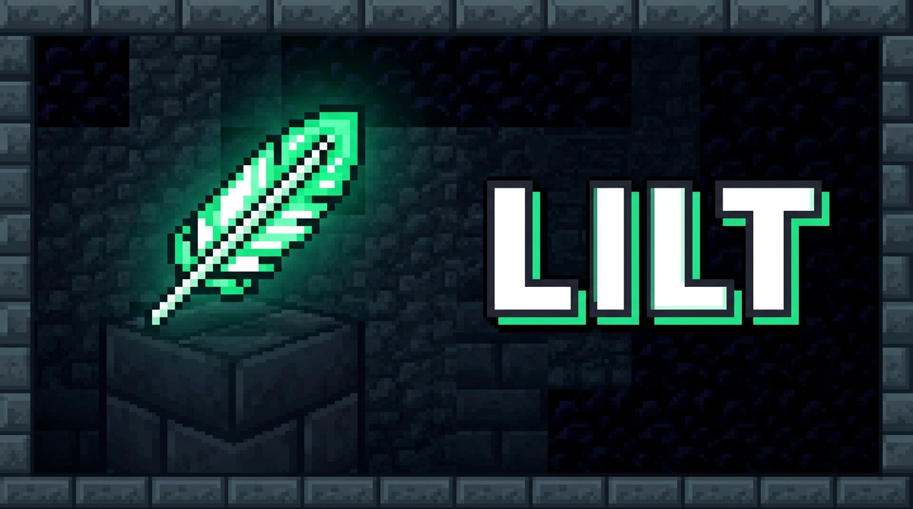

<p align="center">
  
</p>

<p align="center">
  <br>
  <strong>Client-side frame stabilizer and workload optimizer for Minecraft Fabric.</strong>
</p>

---

## What is Lilt?

**Lilt** eliminates sudden framerate drops, micro-stutters, and multi-second freezes on budget laptops, integrated GPUs, and heavily modded setups.

Rather than replacing chunk rendering engines like Sodium, Lilt works alongside them to optimize everything **outside** block rendering: entity animation overhead, singleplayer tick spirals, texture upload bus congestion, and JVM garbage collection pauses.

---

## Key Features

- **Entity Animation LOD** — Scales mob animation update rates based on distance and workload, keeping mob farms and villages smooth without visual degradation.
- **Singleplayer Tick Burst Limiter** — Prevents chunk loading and internal server catch-up loops from freezing the client render thread.
- **Texture Upload Throttling** — Cuts PCIe bandwidth congestion by staggering animated texture copies during frametime spikes.
- **Proactive Memory Guard** — Runs safe garbage collection cycles while paused to prevent stop-the-world GC stutters during active gameplay.
- **Dynamic Spike Detection** — Automatically detects genuine frame delivery spikes ($P_{99} / P_{50}$) and adapts workloads without requiring a static target FPS.
- **Zero-Allocation Telemetry HUD (`F7`)** — Real-time performance metrics (FPS, 1% lows, tick duration, memory, GPU specs).
- **Native Video Settings UI** — Cleanly integrated into both Vanilla Video Settings and Sodium's configuration screen.

---

## Compatibility

Lilt does not modify rendering pipelines destructively and works out-of-the-box alongside popular optimization mods:

| Mod | Compatibility | Role |
|---|:---:|---|
| **Sodium** | Supported | Chunk and terrain rendering |
| **Lithium** | Supported | Server and physics logic |
| **FerriteCore** | Supported | Memory and data structure optimization |
| **EntityCulling** | Supported | Frustum and occlusion culling |
| **ImmediatelyFast** | Supported | Immediate-mode UI and HUD batching |
| **Iris Shaders** | Supported | Shader pack pipelines |

---

## Configuration

Configure in-game via **Options → Video Settings** (or `.minecraft/config/lilt.json`).

- **Low**: Maximum stabilization for budget laptops and integrated graphics.
- **Balanced (Default)**: Recommended preset for standard PCs and modpacks.
- **Performance**: High visual fidelity with safety limits for high-end systems.
- **Custom**: Full manual control over cull distances, budgets, and toggles.

---

## Requirements & Installation

- **Minecraft**: 26.3
- **Fabric Loader**: ≥ 0.19.5
- **Dependencies**: [Fabric API](https://curseforge.com/minecraft/mc-mods/fabric-api)
- **Java**: 25

Place `lilt-1.0.0-26.3.jar` into your `.minecraft/mods` folder.

---

## Building from Source

```bash
git clone https://github.com/shditz/lilt.git
cd lilt
./gradlew build
```
The compiled JAR will be in `build/libs/`.

---

## License

Lilt is released under the [MIT License](LICENSE).
