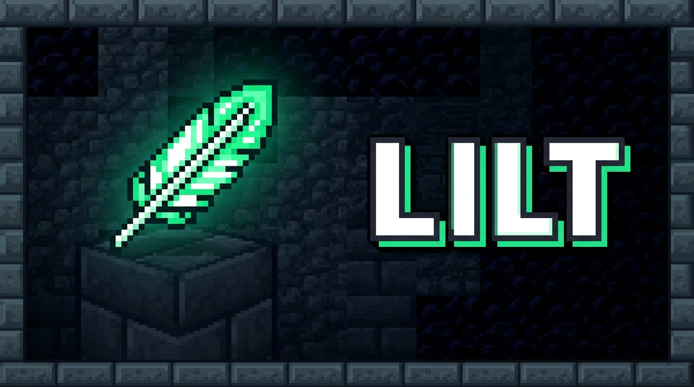

  

   
  <strong>Client-side performance stabilizer and frame-pacing optimizer for Minecraft Fabric.</strong> 
  Supports Minecraft 26.3, 26.2, 26.1.2, 1.21.11, 1.21.4, 1.21 / 1.21.1

---

## What is Lilt?

**Lilt** fixes frametime spikes, micro-stutters, and sudden hitching that chunk-rendering mods do not address.

Mods like **Sodium** do an excellent job rendering terrain and chunk meshes, but games still stutter in everyday scenarios: dense mob farms, villager trading halls, rapid chunk generation in singleplayer, audio floods from stacked mobs, animated texture uploads across PCIe, and stop-the-world Java garbage collection pauses.

Lilt stabilizes these bottlenecks directly on the client render thread without altering game mechanics, changing server behavior, or breaking visuals.

---

## What Lilt Fixes

| Scenario | Vanilla / Sodium Only | With Lilt |
| :--- | :--- | :--- |
| **Mob Farms & Trading Halls** *(50+ entities in one spot)* | Full skeletal/limb animations and shadow geometry calculated every frame for every mob, tanking 1% low FPS. | Distant mobs update animations at stepped intervals. Shadows in complete darkness or far away are skipped. |
| **Stacked Mob Audio** *(Cows, zombies, pistons)* | Hundreds of identical sound events play simultaneously, choking the client audio engine and causing micro-freezes. | Duplicate sound limiter caps repeated mob and piston sounds per second in dense spots without changing volume. |
| **Beacon & Gateway Beams** *(Bases with multiple beacons)* | Vertical beam geometry is submitted for rendering even when beacons are behind the player or out of view. | Frustum culling skips beacon and gateway beam rendering passes when outside the camera's field of view. |
| **Singleplayer Chunk Generation** *(Fast Elytra / Boat travel)* | Internal server thread falls behind and floods the tick loop with catch-up bursts, freezing the client render thread. | Tick burst limiter caps catch-up iterations per frame, keeping camera movement responsive during terrain gen. |
| **Explosions & Boss Fights** *(TNT, Wither, Dragon breath)* | Sudden particle floods cause massive frametime spikes ($P_{99} > 60\text{ ms}$). | Adaptive particle engine scales limits and culls distant particles during lag spikes to keep frame pacing steady. |
| **Animated Textures on iGPUs** *(Water, fire, modded blocks)* | Continuous PCIe buffer copies saturate memory bandwidth on integrated graphics and older GPUs. | Staggers animated texture uploads during frametime spikes and pauses updates when the game menu is open. |
| **Long Play Sessions** *(Java memory accumulation)* | Random 100–500ms Java garbage collection freezes in the middle of active gameplay or combat. | Memory guard runs lightweight GC sweeps during pause and menu screens, preventing mid-fight freeze spikes. |

---

## Features

### 1. Smart Entity Animation LOD
Throttles bone and limb animation updates for distant mobs based on camera distance and current frame pacing. Mobs close to the player remain full speed, while distant mobs in farms or pastures no longer drag down 1% low FPS.

### 2. Duplicate Sound Limiter
In dense farms, hundreds of entities trigger ambient and hurt sounds at the same time. The sound limiter prevents audio thread bottlenecks by capping duplicate sound events (configurable: Unlimited, 8/sec, 4/sec, 2/sec) within nearby coordinates.

### 3. Smart Entity Shadow Culling
Skips entity shadow rendering for mobs that are beyond a set distance (configurable: Off, 16, 24, 32 blocks, or Default) or standing in complete darkness (block light 0 and sky light 0).

### 4. Beacon Beam Culling
Culls beacon beams and End gateway beams when they are outside the player's camera view, saving draw calls around bases with beacon setups.

### 5. Singleplayer Tick Catch-Up Limiter
When singleplayer worlds fall behind during world generation, Minecraft attempts to run dozens of catch-up ticks in a single frame. Lilt caps consecutive catch-up iterations so the render thread never stalls.

### 6. Adaptive Particle Scaling
Dynamically reduces particle budgets and culls distant particles during explosions, wither battles, and dragon breath if the frame pacing drops significantly.

### 7. PCIe Texture Upload Throttling
Reduces animated texture transfer frequency across the PCIe bus during lag spikes or while paused, saving memory bandwidth on integrated GPUs (iGPUs) and budget graphics cards.

### 8. Memory Cleanup on Pause
Triggers safe, lightweight Java garbage collection passes when the pause menu is opened, clearing unused memory before returning to combat or exploration.

### 9. Iris Shader Shield
Runs automatically in the background. Detects when shader packs are rendering shadow map passes and bypasses culling so shader lighting and shadows render correctly.

### 10. Lightweight Diagnostics HUD (`F7`)
Press `F7` to toggle a minimal, zero-allocation performance HUD showing real-time FPS, 1% low FPS, tick duration, memory pressure, and GPU vendor.

---

## Built-In Profiles

Configure Lilt via **Video Settings** (native Minecraft menu or Sodium options page):

- **Medium (Default)**: Balanced profile for everyday survival. Delivers smooth frame pacing with no noticeable visual difference.
- **Low**: Maximum performance for lower-end hardware, budget laptops, and integrated graphics.
- **High**: Full visual distance with protective safety caps for powerful PCs.
- **Server**: Configured specifically for crowded multiplayer servers, mega-bases, trading halls, and mob grinders.
- **Custom**: Full manual control over every slider and toggle.

---

## Mod Compatibility

Lilt does not replace Minecraft's rendering pipeline or overwrite vanilla shaders. It works alongside existing client performance mods:

| Mod | Status | Notes |
| :--- | :---: | :--- |
| **Sodium** | Compatible | Complementary. Lilt adds entity, sound, and client workload optimizations outside Sodium's chunk engine. Integrates directly into Sodium's settings page. |
| **Lithium** | Compatible | Fully compatible with all server-side physics and mob AI optimizations. |
| **FerriteCore** | Compatible | Complementary memory reductions. |
| **ImmediatelyFast** | Compatible | Compatible with HUD and text batching. |
| **EntityCulling** | Compatible | Complementary. EntityCulling skips fully occluded entities; Lilt optimizes animation LOD and shadows for visible distant entities. |
| **Iris Shaders** | Compatible | Automatic shadow pass shield prevents visual artifacts with active shader packs. |

---

## FAQ

**Does this require server installation?**  
No. Lilt is strictly client-side. It works on vanilla servers, Paper, Purpur, Fabric, and Forge/NeoForge servers without sending custom packets.

**Does Lilt change entity hitboxes or mob behavior?**  
No. Animation LOD and shadow culling only affect client visual rendering. Hitboxes, entity reach, physics, and mob AI remain 100% vanilla.

**Can I run Lilt without Sodium?**  
Yes. Sodium is optional. Lilt has its own built-in configuration UI inside Minecraft's standard Video Settings screen.

---

## License

Lilt is licensed under the [MIT License](LICENSE).
